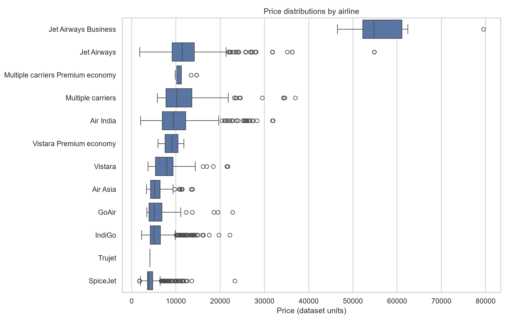
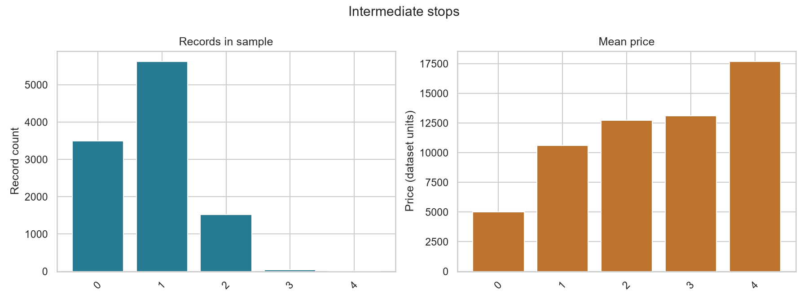
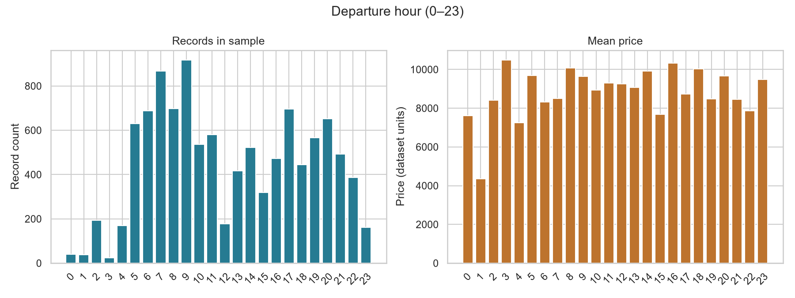

# Flight Price Insights

An exploratory analysis of **10,683 flight-price records** using Python, pandas, NumPy, Seaborn, and Matplotlib. The notebook compares prices across airlines, journey months, weekdays, intermediate stops, and departure hours.

The project includes the dataset, a fully executed notebook, reproducibility checks, and exported charts. It is an analysis project—not a live flight-search service or a price-prediction model.

## What it does

- Checks missing values, duplicate rows, and consistency between route strings and stop counts.
- Parses journey dates explicitly as day/month/year and keeps numeric dates separate from display labels.
- Summarizes count, mean, and median prices for each group.
- Visualizes price distributions, airline differences, monthly and weekday patterns, stops, and departure hours.
- Shows record counts beside mean prices to make small groups visible.
- Checks date parsing, stop-label handling, aggregation totals, finite results, and input preservation.

## Verified findings

These describe the bundled sample, not current fares or causal pricing effects. Currency and original dataset provenance are not documented; prices are reported in dataset units.

| Measure | Result |
| --- | --- |
| Original dimensions | 10,683 rows × 11 columns |
| Journey dates | March 1–June 27, 2019 |
| Price range | 1,759–79,512 |
| Mean / median price | 9,087.06 / 8,372 |
| Largest monthly sample | May: 3,466 records |
| Highest monthly mean | March: 10,673.21 |
| Highest / lowest weekday mean | Friday: 9,718.00 / Monday: 8,499.53 |
| Non-stop flights | 3,491 records; mean price 5,024.90 |
| Missing route / stop count | One of each |
| Exact duplicate rows | 220, retained |

Duplicate rows and price outliers are retained because the repository does not establish whether they are collection errors. One record with an unknown stop count is excluded only from stop-specific summaries. Four-stop flights have just **one record**, so that group's mean is not a robust general finding.

## Visualizations

These charts are regenerated by the corrected notebook and saved to `docs/images/` on each complete run.




| Journey month | Journey weekday |
| --- | --- |
|  |  |

| Intermediate stops | Departure hour |
| --- | --- |
|  |  |

## How to run

Install Git and **Python 3.12**. Windows execution was verified with Python 3.12.14. Direct dependencies are pinned in `requirements.txt`; transitive dependencies are not fully locked. macOS/Linux commands are provided but were not tested on those operating systems.

```bash
git clone https://github.com/SambhavPyakurel/FlightPriceInsights.git
cd FlightPriceInsights
```

**Windows PowerShell:**

```powershell
py -3.12 -m venv .venv
.\.venv\Scripts\python.exe -m pip install -r requirements.txt
.\.venv\Scripts\python.exe -m jupyterlab --notebook-dir=Flight_Analysis
```

**macOS / Linux:**

```bash
python3.12 -m venv .venv
./.venv/bin/python -m pip install -r requirements.txt
./.venv/bin/python -m jupyterlab --notebook-dir=Flight_Analysis
```

Open `Flights.ipynb`, select the environment's Python kernel, and choose **Restart Kernel and Run All Cells**. The notebook supports a working directory of either the repository root or `Flight_Analysis`. Keep the workbook at `Flight_Analysis/flight_price.xlsx`.

To execute and verify without opening the Jupyter interface:

```powershell
# Windows
.\.venv\Scripts\python.exe verify_notebook.py
```

```bash
# macOS / Linux
./.venv/bin/python verify_notebook.py
```

The verification script launches a fresh kernel using its own Python interpreter, runs all cells, validates notebook structure, and saves outputs only after successful execution. It also regenerates the chart images. A successful run ends with `All analysis checks passed.` and `Fresh-kernel execution passed and outputs saved.`

## Corrections and validation

The revised analysis fixes the original month-type mutation, ambiguous date parsing, flight-leg versus intermediate-stop confusion, missing-route handling, and attempts to delete undefined columns. Repeated calculations were consolidated into grouped summaries. Unsupported claims about peak demand and the cheapest travel days were replaced with sample-specific descriptions.

Validation includes:

- A fresh-kernel, top-to-bottom execution on the supplied workbook.
- Checks for valid prices, explicit dates, recognized stop labels, and unchanged input data.
- Regression examples for ambiguous dates, non-stop and connecting flights, missing stop values, and invalid labels.
- Reconciliation of group counts to the full sample, with missing stop counts accounted for separately.
- A route-based cross-check: zero disagreements among records with both usable routes and stop labels.

## Troubleshooting

- **Missing Excel file:** Start from the repository root or `Flight_Analysis`, and keep the original file location.
- **Missing Python package:** Install requirements using the same virtual-environment interpreter that runs Jupyter or the verifier.
- **Wrong notebook kernel:** Launch JupyterLab with the explicit `.venv` command above. The verifier explicitly uses its own interpreter.
- **Validation failure after changing the data:** Inspect the error and quality counts. Unknown stop labels, invalid dates, and invalid prices fail rather than silently producing misleading summaries.
- **Multiple journey years:** The monthly analysis intentionally rejects multi-year inputs; extend it to year-month grouping before analyzing those datasets.

## Project structure

```text
FlightPriceInsights/
|-- README.md
|-- requirements.txt       # Pinned direct analysis/Jupyter dependencies
|-- verify_notebook.py     # Fresh-kernel execution and validation
|-- .gitignore
|-- Flight_Analysis/
|   |-- Flights.ipynb       # Corrected code, explanations, and executed outputs
|   `-- flight_price.xlsx  # Original input, unchanged
`-- docs/images/           # Six regenerated figures
```

## Scope and limitations

The data covers part of 2019 and has undocumented provenance and currency. Dataset record counts do not establish total flights, passenger demand, or peak travel seasons. Airline, route, service class, and date differences can confound comparisons. Small groups require caution; there is no causal analysis, predictive model, live API, or current booking recommendation.

## Can this go on my resume?

**Yes—as an exploratory data analysis project.** The corrected notebook runs reproducibly and demonstrates data validation, aggregation, visualization, and interpretation. Describe your own contributions accurately and be prepared to explain the corrections and limitations.

Suggested bullet:

> Analyzed 10,683 flight-price records with pandas, NumPy, Seaborn, and Matplotlib; validated date and stop-count transformations and compared airfare distributions using reproducible notebook workflows.

For a stronger portfolio entry, document the original dataset source and currency, justify the duplicate policy, and investigate route/class differences before making broader pricing claims. Do not describe this as a trained prediction model.
