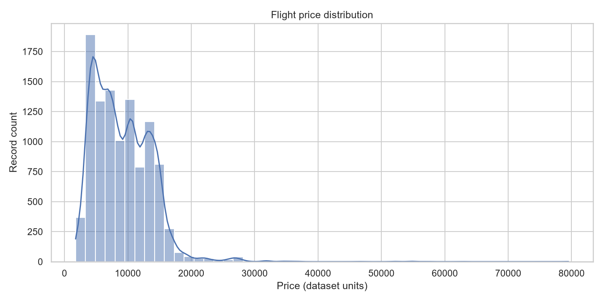
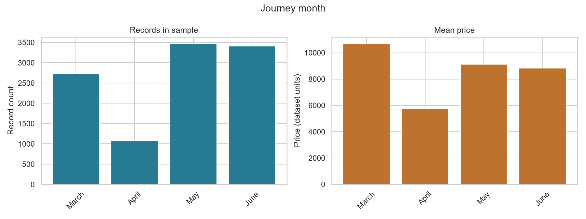
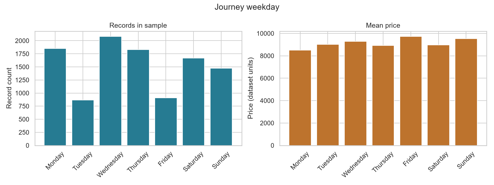

# Flight Price Insights

An exploratory analysis of **10,683 flight-price records**, exploring how prices vary across airlines, journey dates, intermediate stops, and departure hours.

Built with **Python, pandas, NumPy, Seaborn, and Matplotlib**. The project includes the dataset, an executed Jupyter notebook, six exported figures, and a script for reproducing the analysis.



## What the project explores

- **Price distribution** — typical prices, spread, and potential outliers.
- **Airlines** — differences in price distributions, means, and medians.
- **Journey dates** — monthly and weekday patterns in the sample.
- **Intermediate stops** — prices for non-stop and connecting flights.
- **Departure hours** — how average prices and record counts vary by hour.
- **Data quality** — missing values, duplicate rows, and route/stop consistency.

Each grouped comparison includes record counts to help distinguish broad patterns from small samples.

## A few findings

| Measure | Result |
| --- | --- |
| Dataset | 10,683 records, 11 original columns |
| Journey dates | March 1–June 27, 2019 |
| Price range | 1,759–79,512 |
| Mean / median price | 9,087.06 / 8,372 |
| Most records by month | May: 3,466 |
| Highest monthly mean | March: 10,673.21 |
| Highest / lowest weekday mean | Friday: 9,718.00 / Monday: 8,499.53 |
| Non-stop flights | 3,491 records; mean price 5,024.90 |

Prices are reported in dataset units because the repository does not establish currency or original data provenance. These results describe this historical sample, not current fares or booking recommendations.

## Visualizations


| Journey month | Journey weekday |
| --- | --- |
|  |  |

| Intermediate stops | Departure hour |
| --- | --- |
|  |  |

## Run the notebook

Use **Python 3.12**, Git, and a browser.

```bash
git clone https://github.com/SambhavPyakurel/FlightPriceInsights.git
cd FlightPriceInsights
```

**Windows PowerShell:**

```powershell
py -3.12 -m venv .venv
.\.venv\Scripts\python.exe -m pip install -r requirements.txt
.\.venv\Scripts\python.exe -m jupyterlab --notebook-dir=Flight_Analysis
```

**macOS / Linux:**

```bash
python3.12 -m venv .venv
./.venv/bin/python -m pip install -r requirements.txt
./.venv/bin/python -m jupyterlab --notebook-dir=Flight_Analysis
```

Open **`Flights.ipynb`**, select the environment's Python kernel, and choose **Restart Kernel and Run All Cells**. Saved outputs are also available for browsing without rerunning the analysis.

Keep the workbook at `Flight_Analysis/flight_price.xlsx`. The notebook can run from either the repository root or the `Flight_Analysis` directory. Each full run refreshes the charts in `docs/images/`.

### Reproduce from the command line

```powershell
# Windows
.\.venv\Scripts\python.exe verify_notebook.py
```

```bash
# macOS / Linux
./.venv/bin/python verify_notebook.py
```

The script runs the notebook in a fresh kernel, checks for errors, and saves the executed outputs. A successful run ends with `Fresh-kernel execution passed and outputs saved.`

Direct dependencies are pinned in `requirements.txt`. Execution has been verified on Windows with Python 3.12.14; macOS/Linux instructions have not been platform-tested.

## Data handling

Journey dates are parsed as day/month/year. Numeric month and weekday fields are kept separate from display labels. Stop counts come from `Total_Stops`, with route strings used as an independent cross-check.

The original workbook is unchanged. Its 220 exact duplicate rows and price outliers are retained because their provenance is unknown. One missing stop count is excluded only from the stop-specific summary. Validation checks cover date interpretation, stop labels, missing values, group totals, and finite results.

Small groups deserve caution: the four-stop category contains only one record. Differences between groups may also reflect route and service-class differences. The project performs descriptive analysis, not causal inference or price prediction.

## Project structure

```text
FlightPriceInsights/
├── Flight_Analysis/
│   ├── Flights.ipynb       # Analysis and executed outputs
│   └── flight_price.xlsx  # Original dataset
├── docs/images/           # Exported charts
├── requirements.txt       # Pinned direct dependencies
├── verify_notebook.py     # Fresh-kernel execution and checks
└── README.md
```
